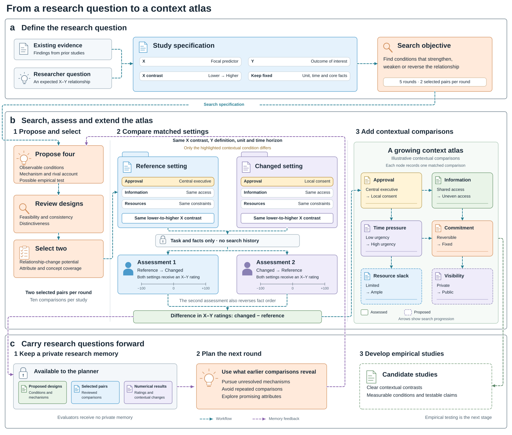
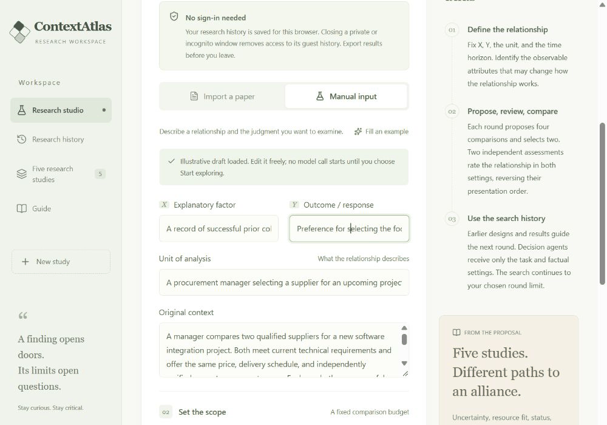
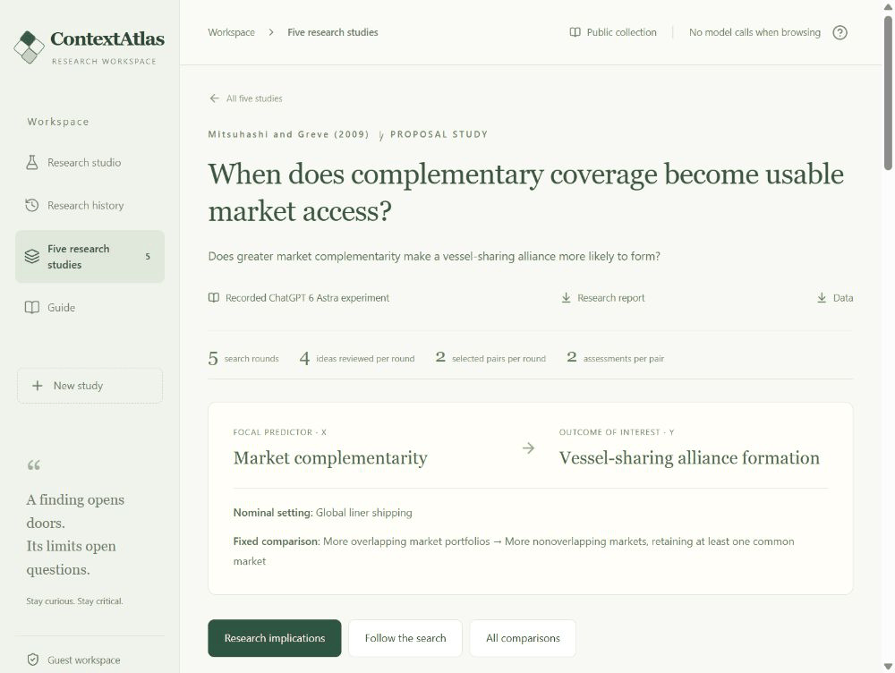
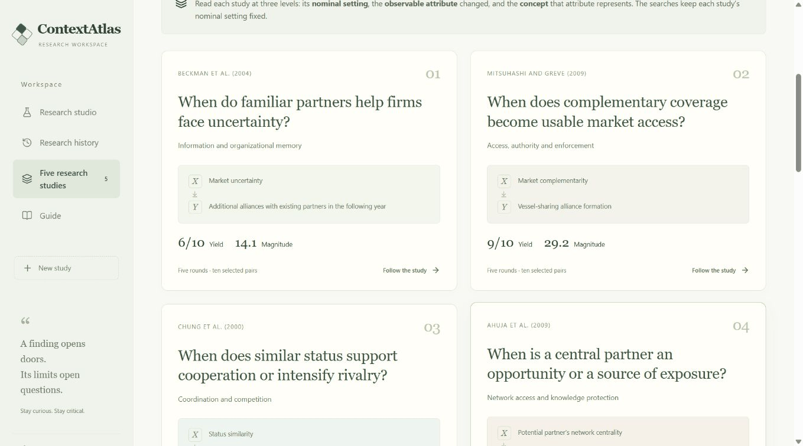

# ContextAtlas

ContextAtlas uses AI agents to help researchers explore the conditions under which a relationship may strengthen, weaken or reverse. Give it a research question and a starting context. It proposes alternative settings, assesses how the relationship changes, and uses what it finds to guide the next round of exploration.

The result is a **context atlas**: a collection of contextual comparisons, model assessments and ideas for follow-up studies. Each comparison records what changed, what stayed fixed and why the difference may matter, helping researchers choose which conditions to investigate empirically.

**[Open the research studio](https://contextatlas.org/)** to explore the workflow and browse examples.

## How it works

1. **Define the relationship.** Specify the factor of interest (X), the outcome (Y) and the original setting. Keep X, Y, the unit of analysis and the time horizon consistent throughout the search.
2. **Develop contextual comparisons.** The planner proposes pairs of settings that differ in one observable condition. For example, a shipping alliance might require approval from a central executive in one setting and consent from local managers in the other.
3. **Review and select.** The system checks whether each comparison is coherent and feasible, then selects promising questions that also broaden the range of attributes and concepts explored.
4. **Assess the relationship.** Decision agents assess the same X–Y relationship in both settings. Each pair receives two independent assessments, with setting and fact order reversed in the second. These agents see the task and facts; the planner's expectations and search history remain separate.
5. **Build on earlier rounds.** The planner uses a growing record of proposals and results to avoid repeating comparisons and pursue unresolved questions. Search continues until the chosen round budget is reached.

By default, each of five rounds proposes four comparisons and selects two, allocating ten comparisons in total. Research memory retains earlier proposals, selected comparisons and numerical results. Later planning builds on this record; model weights are not updated.

Following Levinthal and Rosenkopf (2026), the atlas distinguishes **nominal settings → contextual attributes → broader conceptual categories**. For example, liner shipping is a setting, local approval rights are an observable attribute, and institutional constraints are the broader concept. The reported searches hold each study's nominal setting fixed and explore its attributes. Their reports summarize how often the assessed relationship changes, how large those changes are, and the range of attributes and concepts explored.



*The workflow connects study design, contextual search and relationship assessment through a research memory available to the planner. [View as PDF](docs/media/figure1.pdf) · [PNG](docs/media/figure1.png).*

## Initial evidence

Before context search, we checked the decision agent against published governance results. With its prompt fixed, fresh assessments matched **five of six** supported contextual patterns from Krishnan et al. (2016) and **six of eight** directional effects from Geyskens et al. (2006), in both presentation orders. These papers also informed prompt development, so this is a check against established evidence rather than a held-out accuracy estimate.

We then compared ContextAtlas with one-shot generation using **GPT-6 Astra** across five alliance studies. Each method produced ten final comparisons per study, assessed with the same decision prompt and common eligibility and coverage procedures.

| Measure | One-shot generation | ContextAtlas |
| --- | ---: | ---: |
| Yield | 18/50 (36%) | 27/50 (54%) |
| Magnitude | 8.5 | 14.6 |
| Attribute coverage, mean per study | 9.8 | 9.6 |
| Concept coverage, mean per study | 5.0 | 5.2 |

**Yield** counts comparisons that change the relationship rating by at least ten points in the same direction in both assessments, out of all allocated comparisons. **Magnitude** averages the smaller absolute change across the two assessments for each eligible comparison, assigning zero when the directions disagree. **Coverage** counts distinct changed attributes and their broader concepts among eligible comparisons. The coverage values above are study averages, not percentages. See the [measurement guide](docs/MEASUREMENT.md) for the full definitions.

ContextAtlas found **50% more qualifying comparisons**, with larger rating changes and similar attribute and concept coverage. It had higher yield in three studies, while one-shot generation had higher yield in two. The largest advantage came from shipping: comparisons around approval rights and enforceable market access suggest how complementary markets might translate into alliance opportunities. These are concrete questions for empirical study.

The comparison matches the number of final comparisons; ContextAtlas uses more planning and review calls. The table summarizes the archived research evaluation, while this API package supports new searches. Read the [study findings and evaluation details](docs/RESULTS.md), or inspect the [machine-readable results](docs/example-evidence/five-study-summary.json).

## Explore the completed studies

The [research studio](https://contextatlas.org/) includes the five completed searches on alliances and partner choice. Open **Five research studies** to browse the questions, follow the search rounds and inspect individual comparisons. You can explore these saved results without an API key or starting a new search.

**Start with a question.** The studio guides you through defining the relationship, describing its context and choosing how many rounds to explore.



**Look inside a comparison.** The shipping example asks when complementary market coverage helps firms form an alliance. Open a comparison to inspect the two settings, the assessments, a possible mechanism and an alternative explanation.



**Connect questions across studies.** Browse the five examples to see how different findings lead to questions about information, authority, coordination and organizational experience.



## Run locally

This repository provides the workflow as a command-line application. You can adapt the study inputs and prompts, run searches with your own API credentials, and keep the complete research record locally.

For an API run, install **Node.js 22.13 or later** and **Python 3.10 or later**. From the repository folder, run:

```bash
npm ci
python -m pip install -r requirements.txt
```

To explore the workflow without an API key, run the offline demo. It uses built-in sample responses and saves an example report in `runs/offline-demo/`.

```bash
npm run demo
```

### Run a search with OpenAI

The configuration example uses OpenAI **GPT-6 Astra** through the Python `openai` library. Copy `.env.example` to `.env` and enter your API key:

```dotenv
OPENAI_API_KEY=your-key
LLM_BASE_URL=https://api.openai.com/v1
LLM_MODEL=gpt-6-astra
LLM_REASONING_EFFORT=low
LLM_TOKEN_PARAMETER=max_completion_tokens
```

Then run the shipping example:

```bash
npm run run -- --input examples/shipping-complementarity.json --output runs/shipping-atlas
```

Open `runs/shipping-atlas/report.md` to read the resulting atlas. The same folder contains the individual comparisons, assessments and search memory. Prompts and saved records are in English, and API requests are non-streaming.

Compatible API endpoints can be configured through the same `.env` file. If Python is not on your system path, set `PYTHON` to its executable path. The [architecture guide](docs/ARCHITECTURE.md) explains the runtime and model interface.

### Compare with one-shot generation

Run both methods from the same study input, then evaluate their comparisons together. The baseline proposes its full set of contexts in one request. Using `--defer-evaluation` reserves eligibility and coverage coding for the common evaluation step:

```bash
npm run run -- --input examples/shipping-complementarity.json --method atlas --output runs/shipping-atlas-comparison --defer-evaluation
npm run run -- --input examples/shipping-complementarity.json --method baseline --output runs/shipping-baseline-comparison --defer-evaluation
npm run compare -- --atlas runs/shipping-atlas-comparison --baseline runs/shipping-baseline-comparison --output runs/shipping-comparison
```

These commands make model calls using your configured API. The comparison saves `comparison.md` and `comparison.json`, with common eligibility decisions and one shared coverage vocabulary. It keeps both original run records intact. Use new output folders for a new comparison.

## Explore your own question

Start with an input from [`examples/`](examples/) and adapt it to your research question. The examples cover market uncertainty, market complementarity, status similarity, network centrality and experience with new partners.

A study input defines:

- **The relationship:** X, Y and the lower-to-higher change in X to assess.
- **The setting:** the actors, unit of analysis, time horizon and shared facts.
- **The search budget:** the number of rounds, with two comparisons selected per round.

For example, the [shipping input](examples/shipping-complementarity.json) asks whether greater market complementarity makes a vessel-sharing alliance more likely. The search explores conditions that may change that relationship, such as who can authorize access to a partner's markets.

Save your input as `examples/my-study.json`, then run:

```bash
npm run run -- --input examples/my-study.json --output runs/my-study
```

You can also prepare a draft input from a paper. Save the relevant research excerpt as a UTF-8 text file and run:

```bash
npm run extract -- --input path/to/paper.txt --output runs/extraction.json
```

The extraction includes a `suggestedStudy`, supporting evidence and questions to resolve. Review the draft, save the study specification as a separate JSON file, and use it as the input to a search.

## Work with the results

Each run saves a readable report alongside structured data and the full record of how the atlas developed.

| File | What you can use it for |
| --- | --- |
| `report.md`, `report.json` | Read the contextual comparisons and the four summary measures: yield, magnitude, attribute coverage and concept coverage |
| `results.csv` | Analyze individual comparisons and rating changes |
| `study.json` | Inspect proposals, reviews, selected pairs and assessments |
| `memory.json` | Follow the record used to plan later rounds |
| `calls/*.json` | Inspect the exact model requests and responses |
| `manifest.json`, `usage.json` | Check the run configuration and API usage |

To continue an interrupted search, use its existing output folder:

```bash
npm run resume -- --output runs/my-study
```

The workflow resumes from its saved progress and reuses completed responses. Use a new output folder when changing the study, prompts or model settings. API credentials and local run outputs are excluded from Git by default.

## Documentation

- [Architecture](docs/ARCHITECTURE.md): how the modules work together, share information and maintain research memory.
- [Measurement](docs/MEASUREMENT.md): how yield, magnitude, attribute coverage and concept coverage are calculated.
- [Prompts](docs/PROMPTS.md): the instructions and input formats for each agent.
- [Research examples and evaluation](docs/RESULTS.md): the studies behind the examples and the evaluation approach.

To run the software checks, use `npm test`.
